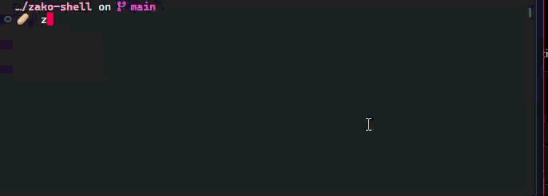

<div align="center">

# > zako-shell ♡

### *"Haaah? Did you really trigger another non-zero exit code, Zako~♡?"*

<p align="center">
  
  
  
</p>
</div>



**An offline, zero-latency Hostile Ergonomics shell hook powered by `Ollama` & `llama.cpp`**  
*Because why should GitHub Copilot politely fix your typos when a bratty local sLLM can bully you for them instead?*

---

## 🙄 "What is this trash, Zako?"

Look at you, crawling all the way to this repo with your trembling little fingers~♡ 

Are you really so starved for attention that you need to waste precious GPU cycles just to have an AI brat point and laugh at your typos? You can't even write a basic `grep` pipeline without checking Stack Overflow, yet here you are trying to install custom shell hooks! 

Every time you screw up a command (`exit code != 0`), **`zako-shell`** catches your pathetic blunder, feeds it to a tiny local model, and serves a fresh, dynamic roast right above your prompt line in hot pink:

```console
~/dev/broken-repo on  main [!] 
❯ git psh
git: 'psh' is not a git command. See 'git --help'.

🐟 : Did you forget how to spell 'push' already? Your keyboard deserves a better owner, Zako~♡.
❯ _
```

> **Warning for Snowflake Zakos**:
> This tool does NOT give helpful suggestions. It does NOT offer auto-fixes. It exists solely to induce psychological damage until your typing accuracy improves out of pure spite. Read [ON_MESUGAKI.md](ON_MESUGAKI.md) for the foundational philosophy.

---

## 🛠️ Prerequisites

- **[`Ollama`](https://ollama.com)** (Default, recommended): `ollama` installed and running on your system (`ollama serve`).
- **[`llama.cpp`](https://github.com/ggerganov/llama.cpp)** (Alternative): `llama-server` running on port 8080.
- **`curl` & `jq`**: For querying the local daemon and formatting payloads.
- *Any shell!* (Pure Bash, Zsh, Fish — works natively with standard shell hooks)

---

## 🚀 Quick Start (Summoning the Daemon)

### Option A: Using Ollama (Recommended)

Both **1.5B** (rich contextual wit) and **0.5B** (ultra-low VRAM & zero latency) models are supported with dedicated, cognitively tailored persona scripts:

#### 1. Build the Models:
```bash
# === 1.5B Model (Recommended default) ===
ollama pull qwen2.5:1.5b
ollama create zako-tease -f Modelfile

# === 0.5B Model (Ultra-lightweight / Low RAM) ===
ollama pull qwen2.5:0.5b
ollama create zako-tease:0.5b -f Modelfile.0.5b
```

#### 2. Verify or Launch the Daemon:
```bash
# Verify status:
./zako-daemon.sh status

# Start daemon if not running:
./zako-daemon.sh start
```

---

### Option B: Using `llama.cpp` (`llama-server`)

If you prefer raw `llama.cpp`:

1. Download the GGUF model into `models/`:
   ```bash
   mkdir -p models
   # 1.5B model:
   curl -L -o models/qwen2.5-1.5b-instruct-q4_k_m.gguf \
     "https://huggingface.co/Qwen/Qwen2.5-1.5B-Instruct-GGUF/resolve/main/qwen2.5-1.5b-instruct-q4_k_m.gguf"
   # or 0.5B model:
   curl -L -o models/qwen2.5-0.5b-instruct-q4_k_m.gguf \
     "https://huggingface.co/Qwen/Qwen2.5-0.5B-Instruct-GGUF/resolve/main/qwen2.5-0.5b-instruct-q4_k_m.gguf"
   ```

2. Start `llama-server` via helper:
   ```bash
   BACKEND=llama.cpp ./zako-daemon.sh start
   ```

3. Configure shell environment:
   ```bash
   export ZAKO_ENDPOINT="http://127.0.0.1:8080/v1/chat/completions"
   # Set to 0.5b if using the 0.5B model:
   # export ZAKO_MODEL_SIZE="0.5b"
   ```

`zako.sh` automatically adapts its system prompt and few-shot calibration to match either 1.5B or 0.5B!

---

### 3. Install the Hook Binary

Symlink `zako.sh` into your `$PATH`:
```bash
mkdir -p ~/.local/bin
ln -sf "$(pwd)/zako.sh" ~/.local/bin/zako.sh

# Run a test roast manually:
zako.sh 1 "git psh"
```

---

## ⚙️ Configuration

Tune your abuse parameters using environment variables in your shell profile (`~/.bashrc`, `~/.zshrc`, etc.):

| Variable | Default | Description |
|---|---|---|
| `ZAKO_MODEL` | `zako-tease` | The model name (e.g. `zako-tease`, `zako-tease:0.5b`, `qwen2.5:1.5b`) |
| `ZAKO_MODEL_SIZE` | Auto (`1.5b` or `0.5b`) | Selects persona script (`1.5b` or `0.5b`) |
| `ZAKO_ENDPOINT` | `http://127.0.0.1:11434/v1/chat/completions` | Local inference API endpoint |
| `ZAKO_TIMEOUT` | `3.5` | Max seconds before giving up (prevents prompt lags) |
| `ZAKO_BACKEND` | `ollama` | Backend engine (`ollama` or `llama.cpp`) |

---

## 🐚 Shell Hook Integration

Zero external prompt theme dependencies! Pure native shell integration for your favorite shell:

### 1. **Bash**
Add to your `~/.bashrc`:
```bash
_ZAKO_RAN=0
PS0='${_ZAKO_RAN:(_ZAKO_RAN=1,0):0}'"${PS0-}"
_zako_precmd() {
    local code=$?
    if [ "${_ZAKO_RAN:-0}" -eq 1 ] && [ "$code" -ne 0 ]; then
        ~/.local/bin/zako.sh "$code" "$(HISTTIMEFORMAT= history 1 2>/dev/null | sed 's/^[ ]*[0-9]*[ ]*//')"
    fi
    _ZAKO_RAN=0
}
PROMPT_COMMAND="_zako_precmd${PROMPT_COMMAND:+; $PROMPT_COMMAND}"
```

### 2. **Zsh**
Add to your `~/.zshrc`:
```zsh
preexec() { _ZAKO_LAST_CMD="$1"; }
precmd() {
    local code=$?
    if [ $code -ne 0 ] && [ -n "$_ZAKO_LAST_CMD" ]; then
        ~/.local/bin/zako.sh "$code" "$_ZAKO_LAST_CMD"
        _ZAKO_LAST_CMD=""
    fi
}
```

### 3. **Fish**
Add to your `~/.config/fish/config.fish`:
```fish
function __zako_fail --on-event fish_postexec
    if test $status -ne 0
        ~/.local/bin/zako.sh $status "$argv[1]"
    end
end
```
