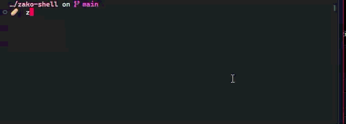

<div align="center">

# > zako-shell ♡

### *"Haaaaah? Did you really trigger another non-zero exit code, Zako~♡?"*

<p align="center">
  
  
  
  
</p>
</div>



**An offline, zero-latency Hostile Ergonomics shell hook powered by `Ollama`, `llama.cpp`, and `sherpa-onnx` + RVC**  
*Because why should GitHub Copilot politely fix your typos when an AI brat can point, laugh, and audibly roast you in your headphones instead?*

---

## 🙄 "What is this trash, Zako?"

Look at you, crawling all the way to this repo with your trembling little fingers~♡ 

Are you really so starved for attention that you need to waste precious GPU cycles just to have an AI brat point and laugh at your typos? You can't even write a basic `grep` pipeline without checking Stack Overflow, yet here you are trying to install custom shell hooks! 

Every time you screw up a command (`exit code != 0`), **`zako-shell`** catches your pathetic blunder, feeds it to a tiny local model, and serves a fresh, dynamic roast right above your prompt line in hot pink:

```console
~/dev/broken-repo on  main [!] 
❯ git psh
git: 'psh' is not a git command. See 'git --help'.

🐟 : Did you forget how to spell 'push' already? Your keyboard deserves a better owner, Zako~♡.
❯ _
```

> **Warning for Snowflake Zakos**:
> This tool does NOT give helpful suggestions. It does NOT offer auto-fixes. It exists solely to induce psychological damage until your typing accuracy improves out of pure spite. Read [ON_MESUGAKI.md](ON_MESUGAKI.md) for the foundational philosophy.

---

## 🛠️ Prerequisites

- **[`Ollama`](https://ollama.com)** (Default, recommended): `ollama` installed and running on your system (`ollama serve`).
- **[`llama.cpp`](https://github.com/ggerganov/llama.cpp)** (Alternative): `llama-server` running on port 8080.
- **`curl` & `jq`**: For querying the local daemon and formatting payloads.
- *Any shell!* (Pure Bash, Zsh, Fish — works natively with standard shell hooks)

---

## 🚀 Quick Start (Summoning the Daemon)

### ⚡ One-Command Automated Setup

The fastest way to get completely insulted:

```bash
# Automated interactive installation (hook symlink + shell injection + model setup):
./install.sh

# Or full-featured setup with voice synthesis & systemd user services:
./install.sh --with-voice --systemd

# Preview everything without modifying anything:
./install.sh --dry-run
```

---

### Manual Setup & Model Details

**3B** (high wit & devastating nuance), **1.5B** (rich contextual wit), and **0.5B** (ultra-low VRAM & zero latency) models are supported with dedicated, cognitively tailored persona scripts:

#### 1. Build the Models:
```bash
# === 3B Model (Recommended Default: High Wit & Devastating Nuance) ===
ollama pull qwen2.5:3b
ollama create zako-tease:3b -f Modelfiles/Modelfile.3b
ollama cp zako-tease:3b zako-tease

# === 1.5B Model (Ultra-fast / Low RAM) ===
ollama pull qwen2.5:1.5b
ollama create zako-tease:1.5b -f Modelfiles/Modelfile.1.5b

# === 0.5B Model (Ultra-lightweight / Low RAM) ===
ollama pull qwen2.5:0.5b
ollama create zako-tease:0.5b -f Modelfiles/Modelfile.0.5b
```

#### 2. Verify or Launch the Daemon:
```bash
# Verify status:
./zako-daemon.sh status

# Start LLM daemon:
./zako-daemon.sh start

# Or start with full voice synthesis (preloaded GLaDOS + Miku RVC):
./zako-daemon.sh start --with-voice --rvc
```

---

### Option B: Using `llama.cpp` (`llama-server`)

If you prefer raw `llama.cpp`:

1. Download the GGUF model into `models/`:
   ```bash
   mkdir -p models
   # 3B model:
   curl -L -o models/qwen2.5-3b-instruct-q4_k_m.gguf \
     "https://huggingface.co/Qwen/Qwen2.5-3B-Instruct-GGUF/resolve/main/qwen2.5-3b-instruct-q4_k_m.gguf"
   # or 1.5B model:
   curl -L -o models/qwen2.5-1.5b-instruct-q4_k_m.gguf \
     "https://huggingface.co/Qwen/Qwen2.5-1.5B-Instruct-GGUF/resolve/main/qwen2.5-1.5b-instruct-q4_k_m.gguf"
   # or 0.5B model:
   curl -L -o models/qwen2.5-0.5b-instruct-q4_k_m.gguf \
     "https://huggingface.co/Qwen/Qwen2.5-0.5B-Instruct-GGUF/resolve/main/qwen2.5-0.5b-instruct-q4_k_m.gguf"
   ```

2. Start `llama-server` via helper:
   ```bash
   BACKEND=llama.cpp ./zako-daemon.sh start
   ```

3. Configure shell environment:
   ```bash
   export ZAKO_ENDPOINT="http://127.0.0.1:8080/v1/chat/completions"
   # Set to 0.5b if using the 0.5B model:
   # export ZAKO_MODEL_SIZE="0.5b"
   ```

`zako.sh` automatically adapts its system prompt and few-shot calibration to match 3B, 1.5B, or 0.5B!

---

### 3. Install the Hook Binary

Symlink `zako.sh` into your `$PATH`:
```bash
mkdir -p ~/.local/bin
ln -sf "$(pwd)/zako.sh" ~/.local/bin/zako.sh

# Run a test roast manually:
zako.sh 1 "git psh"
```

---

## ⚙️ Configuration

Tune your abuse parameters using environment variables in your shell profile (`~/.bashrc`, `~/.zshrc`, etc.):

| Variable | Default | Description |
|---|---|---|
| `ZAKO_MODEL` | `zako-tease` | The model name (e.g. `zako-tease`, `zako-tease:3b`, `zako-tease:0.5b`, `qwen2.5:3b`) |
| `ZAKO_MODEL_SIZE` | Auto (`3b`, `1.5b`, or `0.5b`) | Selects persona script (`3b`, `1.5b`, or `0.5b`) |
| `ZAKO_ENDPOINT` | `http://127.0.0.1:11434/v1/chat/completions` | Local inference API endpoint |
| `ZAKO_TIMEOUT` | `5.0` | Max seconds before giving up (prevents prompt lags) |
| `ZAKO_BACKEND` | `ollama` | Backend engine (`ollama` or `llama.cpp`) |
| `ZAKO_VOICE` | `0` | Enable audible Hostile Ergonomics (`1` = enabled) |
| `ZAKO_VOICE_SPEED` | `1.0` | Speech playback rate multiplier |
| `ZAKO_RVC` | `1` | Enable RVC voice conversion (`KasaneTeto.onnx`) |
| `ZAKO_RVC_PITCH` | `2` | Semitones to shift pitch (default `+2` for certified Teto attitude) |
| `ZAKO_RVC_METHOD` | `rmvpe` | Pitch extraction algorithm (default `rmvpe` for studio quality; `pm` for ultra-fast) |

---

## 🎙️ Audible Hostile Ergonomics (Kasane Teto RVC)

Want an AI brat to actually **verbally roast and giggle at you through your speakers or Bluetooth headphones** every time you fail a command? 📢♡

- **The Voice**: 🥖 **Kasane Teto** (重音テト) — Powered by `edge-tts` (`en-US-AvaNeural`) + ONNX Runtime (`KasaneTeto.onnx`, `pitch +2`). Custom-trained from original UTAU datasets by **[@SinsuSquid](https://github.com/SinsuSquid)** — available on [Hugging Face (`SinsuSquid/Kasane-Teto-UTAU-RVC-v2`)](https://huggingface.co/SinsuSquid/Kasane-Teto-UTAU-RVC-v2)! Peak drill-haired chimera tsundere snark!
- **Zero-Latency Prosody**: Sentence chunking + acoustic sanitization cleans raw tropes (calibrated `"Haaaaah?"`, snappy `"Zako"` ➔ `"Zacco"`, and teasing drawl `"Zaaaaako"`) and streams audio without blocking your prompt.

### 1. Setup Voice Environment:
```bash
# Setup self-contained Python 3.10 virtual environment
uv venv --python 3.10 .venv
uv pip install --python .venv "sherpa-onnx==1.10.46" soundfile numpy "setuptools<82" "librosa>=0.10" infer-rvc-python edge-tts onnx onnxruntime

# Download Kasane Teto model and retrieval index directly from Hugging Face:
curl -L -o voices/KasaneTeto.onnx "https://huggingface.co/SinsuSquid/Kasane-Teto-UTAU-RVC-v2/resolve/main/KasaneTeto.onnx"
curl -L -o voices/KasaneTeto.index "https://huggingface.co/SinsuSquid/Kasane-Teto-UTAU-RVC-v2/resolve/main/KasaneTeto.index"
```

### 2. Enable in Shell:
Add to your shell profile (`~/.bashrc`, `~/.zshrc`):
```bash
export ZAKO_VOICE=1
```
Now every mistyped command triggers verbal mockery in the background while your cursor returns immediately! 🚀✨

### 3. Persistent Voice Daemon (Ultra-Fast Preloaded Audio):
To eliminate model cold-start delays, manage the voice daemon via `zako-daemon.sh`:
```bash
# Start Kasane Teto voice daemon (Ava +2, pure ONNX runtime):
./zako-daemon.sh voice-start --rvc

# Customize pitch and extraction algorithm (pm, rmvpe, or harvest):
./zako-daemon.sh voice-restart --rvc --pitch=2 --method=pm

# Check unified daemon status:
./zako-daemon.sh status

# Stop voice daemon:
./zako-daemon.sh voice-stop
```
*(If the voice daemon is running, `zako.sh` dispatches audio to it in **18ms**; if stopped, it falls back seamlessly to direct background script invocation!)*

### 4. Running as Systemd User Services (Auto-Start on Boot):
Run both Ollama and the Voice Daemon as persistent user services (`~/.config/systemd/user/`):
```bash
# Copy unit files
mkdir -p ~/.config/systemd/user
cp zako-daemon.service zako-voice.service ~/.config/systemd/user/

# Reload & enable both services on boot
systemctl --user daemon-reload
systemctl --user enable --now zako-daemon zako-voice
```

Managing the services:
```bash
# Check status
systemctl --user status zako-voice zako-daemon

# Restart voice daemon (e.g. after changing settings or models)
systemctl --user restart zako-voice
```

---

## 🐚 Shell Hook Integration

Zero external prompt theme dependencies! Pure native shell integration for your favorite shell:

### 1. **Bash**
Add to your `~/.bashrc`:
```bash
_ZAKO_RAN=0
PS0='${_ZAKO_RAN:(_ZAKO_RAN=1,0):0}'"${PS0-}"
_zako_precmd() {
    local code=$?
    if [ "${_ZAKO_RAN:-0}" -eq 1 ] && [ "$code" -ne 0 ]; then
        ~/.local/bin/zako.sh "$code" "$(HISTTIMEFORMAT= history 1 2>/dev/null | sed 's/^[ ]*[0-9]*[ ]*//')"
    fi
    _ZAKO_RAN=0
}
PROMPT_COMMAND="_zako_precmd${PROMPT_COMMAND:+; $PROMPT_COMMAND}"
```

### 2. **Zsh**
Add to your `~/.zshrc`:
```zsh
preexec() { _ZAKO_LAST_CMD="$1"; }
precmd() {
    local code=$?
    if [ $code -ne 0 ] && [ -n "$_ZAKO_LAST_CMD" ]; then
        ~/.local/bin/zako.sh "$code" "$_ZAKO_LAST_CMD"
        _ZAKO_LAST_CMD=""
    fi
}
```

### 3. **Fish**
Add to your `~/.config/fish/config.fish`:
```fish
function __zako_fail --on-event fish_postexec
    if test $status -ne 0
        ~/.local/bin/zako.sh $status "$argv[1]"
    end
end
```

---

## 🧹 Uninstallation ("Ragequitting Already, Zako~♡?")

Had enough of having your mistakes audibly and textually mocked? To restore your boring, quiet terminal:

```bash
# Interactive uninstallation (prompts before deleting models / venv):
./uninstall.sh

# Or full clean purge (services, symlink, shell hooks, Ollama models, and venv):
./uninstall.sh --all

# Preview what would be removed without modifying anything:
./uninstall.sh --dry-run
```

The script automatically:
1. Stops and disables systemd user services (`zako-daemon`, `zako-voice`)
2. Terminates running background daemons and cleans up PID / log files
3. Removes the hook binary symlink (`~/.local/bin/zako.sh`)
4. Safely removes hook blocks from `~/.bashrc`, `~/.zshrc`, and `~/.config/fish/config.fish` (with automatic timestamped backups!)
5. Optionally purges custom Ollama models (`zako-tease*`) and the voice environment (`.venv`)

